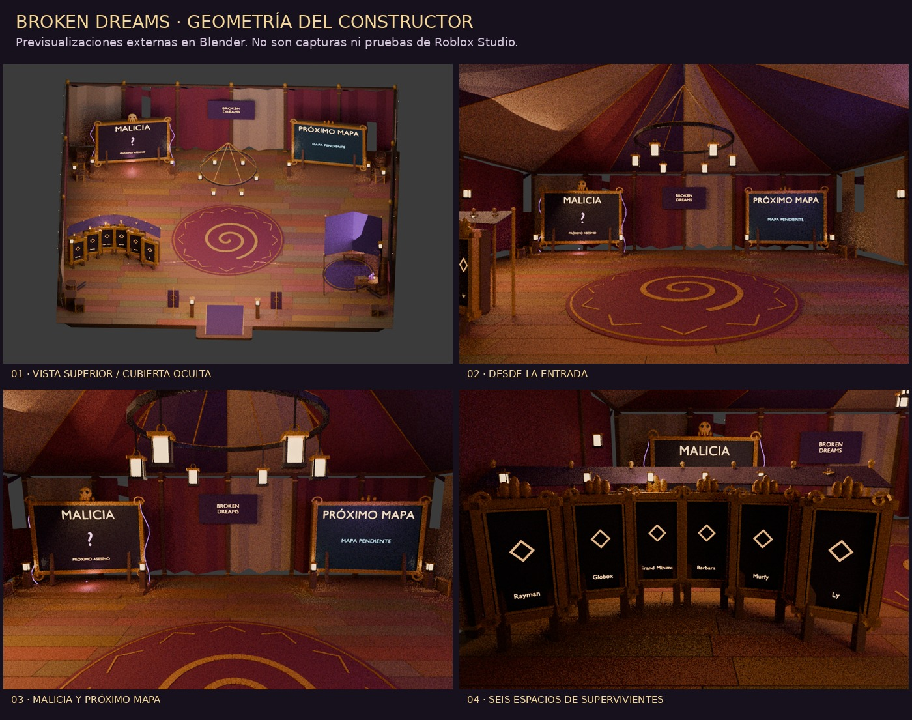

# BROKEN DREAMS — Lobby

Entrega del lobby 3D ya construido en un proyecto nativo de Roblox. BROKEN DREAMS es un juego independiente.

## Descargar y abrir

- **[Descargar proyecto .rbxlx](https://raw.githubusercontent.com/edgardofalconv-design/broken-dreams/refs/heads/delivery/lobby-20261114/dist/Broken-Dreams-Lobby.rbxlx)**
- **[Descargar ZIP completo](https://raw.githubusercontent.com/edgardofalconv-design/broken-dreams/refs/heads/delivery/lobby-20261114/dist/Broken-Dreams-Lobby-Entrega.zip)**
- [Guía de apertura y configuración](GUIA_ABRIR.md)

En Roblox Studio: **Archivo → Abrir desde archivo → Broken-Dreams-Lobby.rbxlx**. El escenario ya está guardado dentro del proyecto; no requiere ejecutar un instalador. Pulsa Play para recorrerlo.

No hay que importar accesorios, meshes ni texturas para visualizar este lobby. Los retratos definitivos y las imágenes de mapas quedan pendientes de los archivos originales del creador.

## Alcance

Sala de 72 × 60 studs; Malicia al fondo a la izquierda, Próximo mapa a la derecha, seis cuadros de supervivientes, rincón de skins, alfombra central, cubierta, faroles y decoración 3D. Temporizador preparado, sin botón Jugar ni sistema de partidas activo.

El ZIP contiene el lugar, un modelo .rbxmx opcional, scripts, datos geométricos, herramientas de inspección, guía y vistas previas.

## Validación

Se verificaron serialización y lectura del .rbxlx mediante Lune/rbx-dom, 3.550 piezas guardadas, scripts y atributos, referencias XML y compilación Luau. El ZIP se comprobó mediante CRC y los archivos se identifican en [SHA256_ENTREGA.json](SHA256_ENTREGA.json).

**No se ha ejecutado Roblox Studio en el entorno de preparación.** Play, física real, interfaces, multijugador y rendimiento deben comprobarse en Studio. El detalle artístico es una aproximación con piezas nativas a la referencia.

