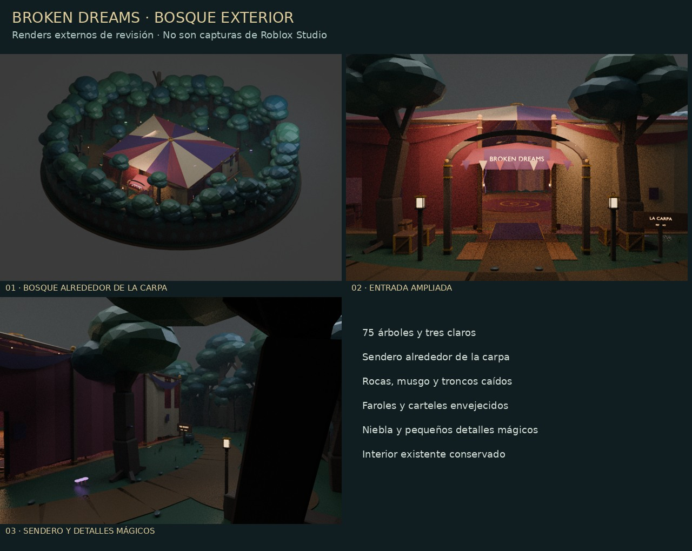

# BROKEN DREAMS — Lobby con bosque exterior

Ampliación del lobby existente con un bosque explorable alrededor de la carpa y una entrada renovada.

## Descargar

- **[Proyecto .rbxlx listo para abrir](https://raw.githubusercontent.com/edgardofalconv-design/broken-dreams/refs/heads/delivery/lobby-bosque-20261114/dist/Broken-Dreams-Lobby-Bosque.rbxlx)**
- **[ZIP completo con proyecto, recursos y guía](https://raw.githubusercontent.com/edgardofalconv-design/broken-dreams/refs/heads/delivery/lobby-bosque-20261114/dist/Broken-Dreams-Lobby-Bosque-Entrega.zip)**
- [Guía de apertura y cambios](GUIA_BOSQUE.md)

En Roblox Studio: **Archivo → Abrir desde archivo → Broken-Dreams-Lobby-Bosque.rbxlx**. El escenario ya está construido; no requiere instalador ni importar recursos para visualizarlo.

## Ampliación

75 árboles, hierba, sendero de tierra alrededor de la carpa, tres claros, piedras con musgo, troncos caídos, niebla suave y un límite natural de vegetación, raíces y taludes rocosos. Entrada ampliada con arco, toldo, banderines, faroles, cajas, barriles y carteles viejos. Pequeños hongos luminosos y cristales completan el ambiente.

Se conserva el interior y los scripts de servidor. Solo se retira el antiguo bloqueo de la entrada y se amplía la comprobación del área de cámara y HUD para incluir el exterior.

## Validación

La lectura del .rbxlx, las referencias XML, la compilación Luau y las pruebas geométricas locales pasan: 948 posiciones de recorrido y 720 comprobaciones del límite exterior. Se conservaron 3.549 piezas originales sin cambios; la única pieza retirada es el límite transparente detrás de la entrada.

**No se ha ejecutado Roblox Studio aquí.** Play, saltos, cámara real, multijugador y rendimiento deben probarse en Studio. Los renders son externos, no capturas del motor.

- [Informe de validación](VALIDACION_BOSQUE.json)
- [Hashes SHA-256 de descarga](SHA256_BOSQUE.json)
- [Entrega anterior conservada](https://github.com/edgardofalconv-design/broken-dreams/tree/8e3b94042fab518854c0976a617b0a7a0c3f2870)

